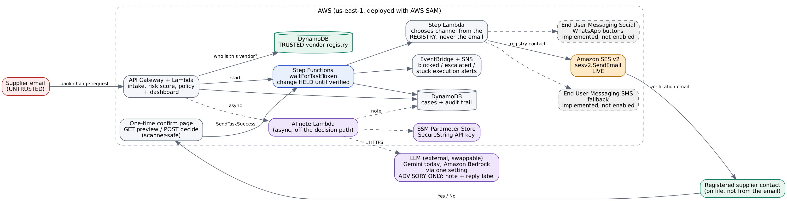

# PayeeChange Guardian

**An email can request a payment change. It cannot authorize one.**

When a supplier email says "we changed banks", PayeeChange Guardian holds the change and verifies it only through
the contact already in the trusted vendor record. Any phone number or email address inside the request is ignored.

Built for the AWS Communication Developer Services Agentic AI Partner Hackathon.



## What is live, and what is not (read this first)
| Part | Status |
|---|---|
| Hold, risk scoring, policy, audit trail, dashboard | Live on AWS (us-east-1) |
| Verification by **Amazon SES** (`sesv2.send_email`) to the registered contact, with one-time confirm pages | **Live**, exercised end to end |
| WhatsApp (End User Messaging Social) and SMS (End User Messaging SMS) | **Implemented and unit-tested** against SDK call shapes, **not enabled** in the deployed account (service access was not available on the free plan). Switch on with `EnabledChannels` |
| Advisory AI note on each case and free-text reply classification | Live, using an **external LLM (Gemini free tier)** called from a Lambda. The model is a swappable component: Amazon Bedrock is used instead when `AiProvider=bedrock` |
| SES inbound (supplier mail arrives by email) | Implemented in the template, off by default (needs a domain). The dashboard scenarios inject the same raw email through the same code |

## How it works
1. **Intake.** A bank-detail email is parsed (IBAN, contacts, sender domain, urgency, amount). Case state lives in DynamoDB.
2. **Risk and policy (deterministic code).** Signals include a changed payee account, contact details not in the
   trusted record, an unseen sender domain, reply-to redirects, failed SPF/DKIM, pressure wording and amount anomalies.
   **Any change to the payee account is verified out of band, regardless of score.**
3. **Hold.** A Step Functions execution holds the change with `waitForTaskToken`. Existing payee details stay in force.
4. **Verify through the registry.** The verification contact is read from the vendor record, never from the email.
   The registered contact gets one-time Yes / No links. The confirm page previews on GET and decides only on POST, so
   email scanners that prefetch links cannot answer for the supplier. Both tokens are burned on first use.
5. **Interpret the reply.** Button presses are authoritative. Free text goes through rules, then the model. The model
   returns a label only: "yes, but only if..." is escalated, low confidence or a model error never approves, and DENY always blocks.
6. **Decide.** After a confirmation, secondary checks run (account checksum, account not registered to another vendor).
   Only then are payee details updated. Unclear outcomes go to a human approver by email.
7. **Advise.** A background Lambda asks the LLM for a two-sentence plain-English note and tags (urgency, secrecy, contact
   redirect...). It never touches routing or the decision, and a model outage only means "no AI note".
8. **Audit and alert.** Every step is on the dashboard timeline. EventBridge alerts on blocked, escalated and stuck cases.

### AWS Communication Developer Services at runtime
| Service | SDK client | Call | File |
|---|---|---|---|
| Amazon SES v2 | `sesv2` | `send_email` (verification, approver) | `src/guardian/channels/messenger.py` |
| End User Messaging Social (WhatsApp) | `socialmessaging` | `send_whatsapp_message` | same file (not enabled in the demo account) |
| End User Messaging SMS | `pinpoint-sms-voice-v2` | `send_text_message` | same file (not enabled in the demo account) |

## Try it
**Judges, no setup:** open the dashboard URL from the submission. Click **Fraud attempt**, then open the case. Use
"Yes, we made this change" / "No, we did not" to answer as the registered supplier (the real email goes to a demo
mailbox that judges do not own; the buttons use the same reply code path and are labelled in the audit trail).
Try **Real supplier change** for the approval path, type a conditional reply such as "yes, but only if you pay by
Friday" to see escalation, and use the reset icon to start over.

**Offline, no credentials:**
```bash
pip install pytest
python -m pytest -q          # 38 tests
python scripts/run_local_demo.py
```

## Deploy
Needs an AWS account, a verified SES identity (an email address is enough) and the AWS SAM CLI.
```bash
sam build
sam deploy --guided                      # parameters are described in template.yaml
python scripts/seed_vendors.py           # env: VENDORS_TABLE, DEMO_PHONE, APPROVER_EMAIL, SUPPLIER_EMAIL
```
Redeploy once with `PublicBaseUrl=<DashboardUrl without trailing slash>` so email links work.
Optional AI note: store a key with
`aws ssm put-parameter --name /payee-guardian/ai-api-key --type SecureString --value <key>` and deploy with
`AiProvider=gemini` (or `groq`, or `bedrock` with `BedrockModelId`). Credentials come from your IAM role; no secrets are in this repo.

## Design decisions
- Verification contacts come only from the registry (`engine.send_verification` uses the plan built in `risk.plan_verification`).
- A reply only counts from the channel we contacted; email answers use random one-time tokens.
- The public API strips tokens and masks contact details. Demo data is synthetic (`.example` domains, fictional vendors).
- The LLM is advisory. It cannot choose a destination, approve a change or override a DENY.

## Honest limits
- WhatsApp and SMS paths have not been run against live AWS (no access on the demo account); SES has.
- The simulate buttons are public by design for judging; production would put the dashboard behind authentication.
- The AI note depends on a free-tier external model and can be slow or unavailable; the case is unaffected when it is.

## License
MIT. See `LICENSE`.
